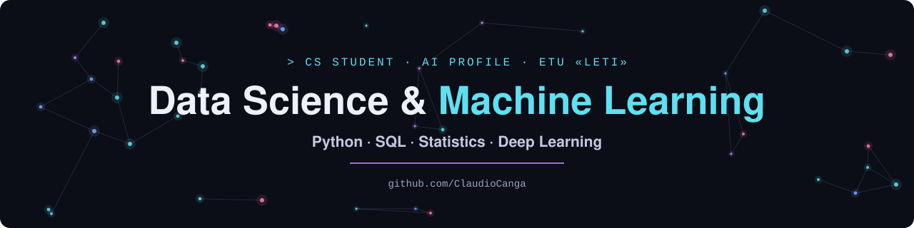

### Hi, I'm Cláudio

Computer Science student at **ETU «LETI»** (Saint Petersburg), AI profile, working toward **Machine Learning / Applied AI engineering**. I also work remotely as a backend developer, building healthcare software with PHP/Laravel and Python.

**Currently**
- Exploratory data analysis and visualization with Python
- Statistics, linear algebra and the math behind ML
- Building a portfolio of data projects, pinned below

**Highlights**
- **[Euro 2024 — Exploratory Data Analysis](https://github.com/ClaudioCanga/euro2024-eda)** — analysis of all 51 matches of UEFA Euro 2024 with StatsBomb open data (~188k events): goals per match, scoring by stage and stadium, and finishing efficiency. Python, pandas, Matplotlib.
- **[Pulso Seguro](https://github.com/nangazaki/pulso-seguro)** — final-year project at ITEL: a wearable (ESP8266 + MAX30102 sensor) that monitors heart rate and blood oxygen, streams readings over MQTT and raises alerts in a web dashboard. I built the electronics, the firmware and the whole backend.
- **Biometric patient identification** (at work, private repository) — a Python/Flask bridge for a fingerprint reader, integrated with a Laravel REST API in a hospital-management system.

**Stack**

**Languages:** Portuguese · Russian · English

